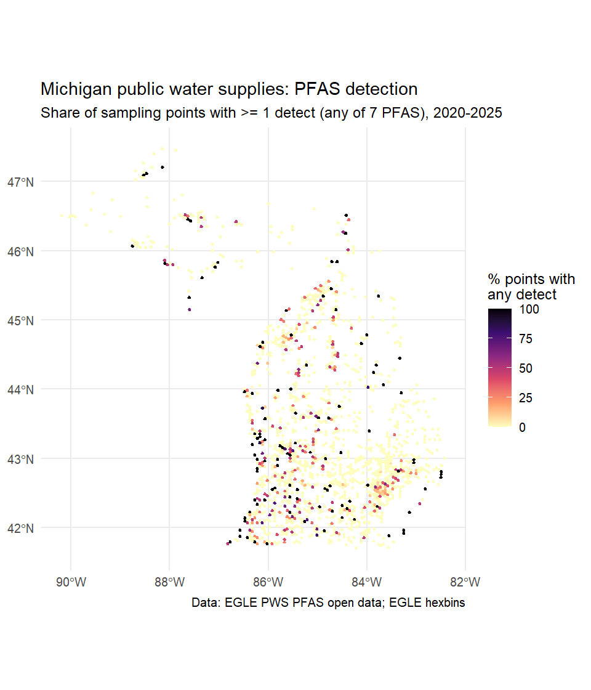
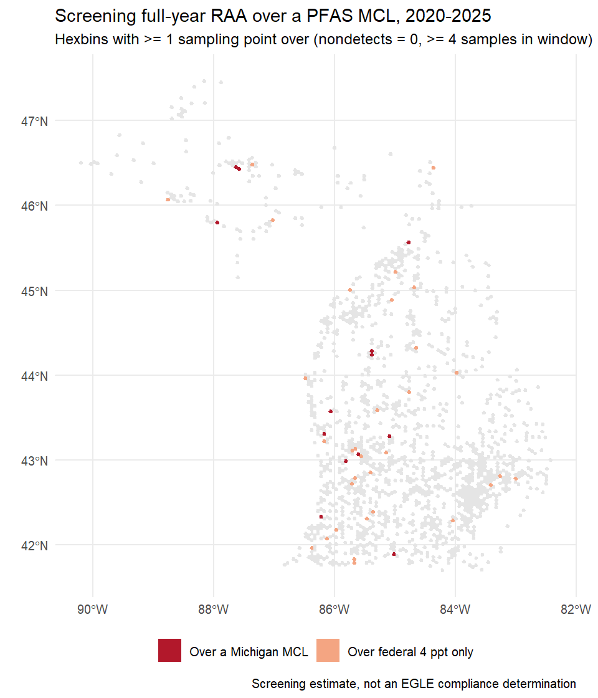
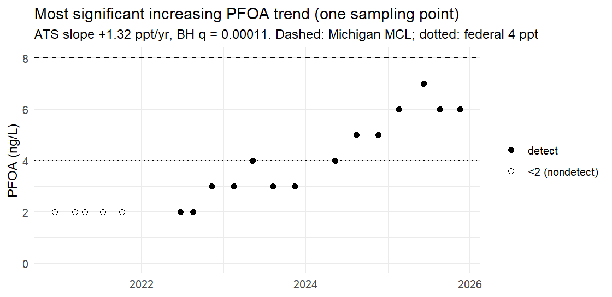
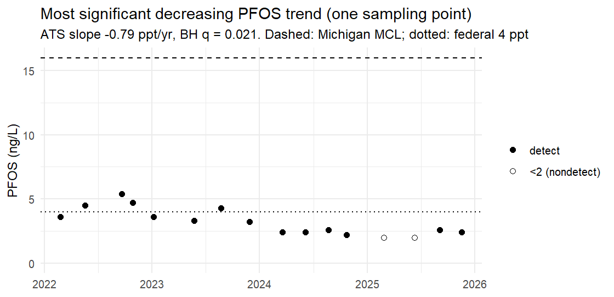
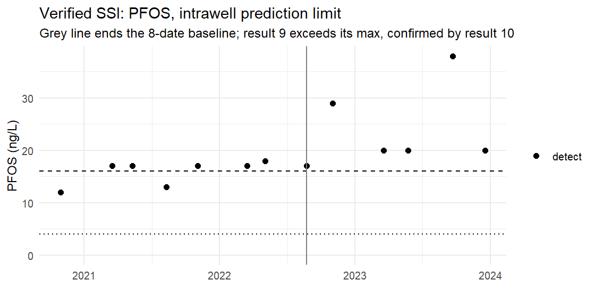
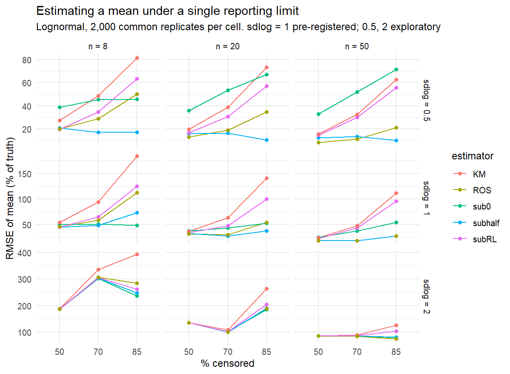

```{r setup}
o <- function(f) read.csv(file.path("outputs", f))
qc <- o("qc_log.csv"); occ <- o("A_occurrence.csv"); b <- o("B_raa_screen.csv")
mi <- o("B_raa_points_michigan.csv"); us <- o("B_raa_points_federal.csv")
tr <- o("C_trends.csv"); cs <- o("C_trend_summary.csv"); cba <- o("C_trend_by_analyte.csv")
ss <- o("D_ssi.csv"); sim <- o("E_simulation.csv"); simx <- o("E_simulation_sdlog_exploratory.csv")
x <- readRDS("data/clean.rds")
manifest <- readLines("data/raw/MANIFEST.txt")
sys_of <- function(p) unique(sub(":.*", "", p))
pts <- function(d, col) unique(d$point[!is.na(d[[col]]) & d[[col]] > d$mcl])
mi4 <- pts(mi, "raa4_nd0"); us4 <- pts(us, "raa4_nd0")
mil <- pts(mi, "raa4_latest_nd0"); usl <- pts(us, "raa4_latest_nd0")
f <- function(v, d = 0) formatC(v, format = "f", digits = d, big.mark = ",")
kt <- function(d, ...) knitr::kable(d, row.names = FALSE, ...)
```

## Summary

Michigan has required public water supplies to test for seven PFAS since August 2020. This report analyzes every result the state has published, `r f(nrow(x))` analyte results at `r f(length(unique(x$point)))` sampling points in `r f(length(unique(x$WSSN)))` systems. It uses the censored-data methods applied in groundwater detection monitoring (EPA 2009 Unified Guidance; Helsel 2012). The analysis plan was pre-registered before any statistic was computed ([PREREG.md](PREREG.md)), and both of its falsification tests fired.

- **Most results are nondetects.** `r f(100 - 100 * mean(!x$censored), 1)`% are below the 2 ng/L reporting limit. A statewide mean would mostly reflect an assumption about values nobody measured, so none is reported.
- **The federal limit would catch about 3–4 times as many points as Michigan's.** `r length(mi4)` sampling points (`r length(sys_of(mi4))` systems) had a full-year running annual average (RAA) over a Michigan MCL at some point. `r length(us4)` points (`r length(sys_of(us4))` systems) were over the federal 4 ppt PFOA or PFOS limit. In each point's most recent full year, the counts are `r length(mil)` points (`r length(sys_of(mil))` systems) for Michigan and `r length(usl)` points (`r length(sys_of(usl))` systems) for federal. How nondetects are treated barely matters: at most `r max(b$flips_nd_convention)` points change status.
- **Levels are not measurably falling statewide.** Among `r cs$fdr_significant` FDR-significant trends, `r cs$increasing` are increasing and `r cs$decreasing` decreasing (sign test p = `r f(cs$sign_test_p, 2)`). The pre-registered falsifier fired, so I don't claim a decline.
- **The textbook rule didn't hold in this simulation.** With a single reporting limit, substituting RL/2 matched or beat regression on order statistics (ROS) on error at the pre-registered spread, and I report that as it came out. Kaplan–Meier was never the best estimator and was the worst in 15 of 27 cells.

These are screening estimates on public data, not EGLE compliance determinations, and they make no health claims.

## Data and quality control

Source: EGLE *Public Water Supply Sampling* open data (ArcGIS FeatureServer), pulled by `R/ingest.R`. `r manifest[1]`; `r manifest[4]`.

```{r qc}
kt(setNames(qc, c("QC step", "Rows")), caption = "Every exclusion is counted (data/qc_log.csv)")
```

The two rules that change results:

- **Mirror rows.** The same EGLE-lab sample appears twice, once under "Lansing Lab" with no sampling-point name. The unlabeled copy is dropped only when a labeled row has identical results for the same system and date.
- **Suspected unit errors.** Results ≤ 0.01 ppt look like µg/L entered as ng/L. Everything below 0.1 ppt is excluded, not converted, because the unit is a guess.

When the same point, date, and compound has a detect and a "<2", the average is taken over detects only. A "<2" is not a measured 2.

PREREG.md cites 49 sub-0.1 results; that count was taken after same-day repeats were collapsed. The table counts them before collapsing.

## A. Occurrence

```{r occ}
occ$p95 <- ifelse(occ$p95 == 0, "<2", occ$p95); occ$p99 <- ifelse(occ$p99 == 0, "<2", occ$p99)
kt(data.frame(Analyte = occ$analyte, Points = f(occ$points),
              `Points ever detected` = paste0(occ$points_detected, " (", f(occ$pct_points_detected, 1), "%)"),
              `Results censored` = paste0(f(occ$censored_pct, 1), "%"),
              `95th pct of point max` = occ$p95, `99th pct` = occ$p99, check.names = FALSE),
   caption = "One value per sampling point (its maximum), because points with detects are sampled more often")
```

Sample-level statistics would overweight contaminated points: Michigan's rule moves a point with a detect to quarterly sampling. So each point counts once.

{width=75%}

## B. Compliance screening

Michigan judges compliance on a running annual average at each sampling point. Here, the RAA is the mean over a trailing 365-day window, and a "full-year RAA" requires at least 4 samples in that window.

Nondetects enter as 0, following the federal 2024 rule; I did not verify Michigan's rule text on this. Setting them to 2 ppt instead gives an upper bound.

```{r raa}
kt(data.frame(Standard = b$standard, Analyte = b$analyte, `MCL (ppt)` = f(b$mcl),
              `Any single result over` = b$any_result_over,
              `Full-year RAA over (ND=0)` = b$raa4_over_nd0, `(ND=RL)` = b$raa4_over_ndRL,
              `Latest full-year RAA over` = b$latest_raa4_over_nd0, check.names = FALSE),
   caption = "Sampling points, 2020-2025. Federal PFOA/PFOS MCLs: April 2024 rule; compliance due 2029 (EPA has proposed 2031)")
```

{width=75%}

Federal 4 ppt is the binding constraint. `r length(setdiff(us4, mi4))` points that never exceeded a Michigan MCL did exceed the federal one. That is where treatment and remediation work would come from as the 2029–2031 deadline approaches. EPA's pending proposal keeps the PFOA/PFOS limits and would rescind the PFHxS, PFNA, GenX, and hazard-index MCLs. Michigan's own MCLs for those compounds stay in force regardless.

## C. Trends

`r f(cs$tests)` point × compound series qualified: ≥ 8 dates spanning ≥ 2 years, with ≥ 3 detects. Each was tested with the Akritas–Theil–Sen test, a Kendall-based trend test for censored data (NADA2). Benjamini–Hochberg FDR control was set at q = 0.10.

```{r trends}
w <- reshape(cba, idvar = "analyte", timevar = "direction", direction = "wide")
names(w) <- c("Analyte", "Decreasing", "Increasing")
kt(w, caption = sprintf("FDR-significant trends: %d of %d tests, at %d points", cs$fdr_significant, cs$tests,
                        length(unique(tr$point[tr$q < 0.1]))))
```





**What this does and doesn't show.** The pre-registered test: if significant increases aren't outnumbered by decreases, no statewide decline is claimed. Here there are `r cs$increasing` increases and `r cs$decreasing` decreases, sign test p = `r f(cs$sign_test_p, 2)`, so the falsifier fired.

The ratio is also biased toward increases by design. A rising point stays on quarterly monitoring and qualifies for a trend test. A falling point moves to annual sampling and usually doesn't. So this is not evidence that PFAS levels are rising statewide either. The defensible statement is narrower: at least `r cs$increasing` monitored series show statistically supported increases, and those are the ones worth a closer look.

## D. Intrawell detection monitoring

This applies Unified Guidance detection monitoring to each series with more than 8 dates. The first 8 dates are the baseline.

- **Baseline all nondetects:** the *double quantification rule* applies. An SSI (statistically significant increase) is two consecutive detects.
- **Otherwise:** the nonparametric prediction limit is the baseline maximum, with one verification resample. If the data are independent and identically distributed, each evaluation has a false-positive probability of 1/45 ≈ 2.2%: the chance that both later results are the two largest of 10.

```{r ssi}
t <- as.data.frame.matrix(table(ss$rule, ss$status))
kt(cbind(Rule = rownames(t), t), caption = sprintf("Verified SSIs at %d sampling points", length(unique(ss$point[ss$status == "SSI"]))))
```



**Caveat.** Each series is evaluated sequentially, up to `r max(ss$n) - 8` times, so the chance of at least one false SSI per series is well above 2.2%. The Unified Guidance sets a site-wide false-positive target for exactly this reason. Treat these SSIs as a screening list, not confirmed changes.

## E. Method check: which mean estimator holds up under one reporting limit?

The simulation drew lognormal samples censored at a single reporting limit, with 2,000 replicates per cell. All five estimators were scored **on the same replicates**: KM and ROS need at least 2 detects, and scoring them only on their successful runs would favor them.

```{r sim}
s <- sim[, c("n", "cens_rate", "failed_pct", "estimator", "rmse_pct")]
s$rmse_pct <- round(s$rmse_pct, 1)
w <- reshape(s, idvar = c("n", "cens_rate", "failed_pct"), timevar = "estimator", direction = "wide")
names(w) <- sub("rmse_pct.", "", names(w))
w$cens_rate <- paste0(100 * w$cens_rate, "%"); w$failed_pct <- paste0(round(w$failed_pct), "%")
kt(setNames(w, c("n", "Censored", "Runs with <2 detects", "sub 0", "sub RL/2", "sub RL", "KM", "ROS")),
   caption = "RMSE of the mean, % of truth; sdlog = 1 (pre-registered)")
```



**Result.** The pre-registered falsifier fired. At σ_log = 1, RL/2 substitution matches ROS (within 10%) or beats it in every cell. ROS wins on bias at n = 50, but RL/2's lower variance more than offsets its bias.

The exploratory runs at σ_log 0.5 and 2 were not pre-registered:

- **σ_log = 0.5:** ROS beats RL/2 only at 50% censoring with n ≥ 20, and at 70% with n = 50. RL/2 wins everywhere else, with 2–3× lower error at 85%.
- **σ_log = 2:** the two are within 1% except in two cells, which split: RL/2 is better at n = 8 with 85% censoring, and ROS at n = 50 with 85%.

All results are conditional on at least 2 detects (the common replicates), which pushes every estimator upward at small n.

**Takeaways for this data:**

- Kaplan–Meier is the wrong tool when there is a single reporting limit below every detect. It can't place mass below the limit, so it behaves like substituting the limit. It was never best and was worst in 15 of 27 cells.
- At n = 50, substituting 0 is biased low and substituting the RL is biased high at every spread.
- At n = 8 and 85% censoring, two-thirds of samples have fewer than 2 detects. That supports the pre-registered rule of reporting no mean once censoring passes 80%.

## Limitations

- **Drinking water, not monitoring wells.** These are public-supply sampling points, some after treatment, so a "decreasing" series may simply be a filter being installed.
- **Locations are hexbins.** EGLE publishes about 1,450 hexbins, not coordinates, so no spatial statistics beyond mapping were attempted.
- **The nondetect rule is assumed.** RAA nondetects follow the federal convention; Michigan's rule text was not verified on this point.
- **Sampling is informative.** Sampling frequency depends on past results, which biases any pooled or cross-point summary. That is handled by counting each point once (A) and by stating the bias (C), not corrected.

## Reproduce

```
Rscript R/ingest.R   # pull current EGLE data (data/raw/, MANIFEST.txt)
Rscript R/run.R      # QC + analyses A-F -> outputs/, figures/ (~3 min)
Rscript -e 'testthat::test_dir("tests/testthat")'
quarto render report.qmd
```

R `r getRversion()`; EnvStats, NADA2, sf, ggplot2. Built with AI coding assistance (Claude Code); I reviewed the methods, code, and results.
